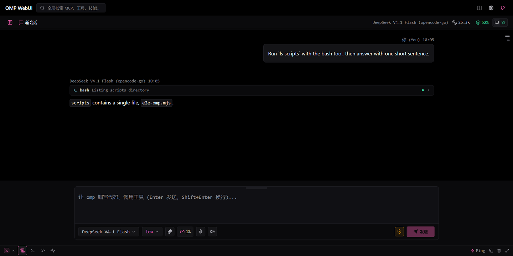
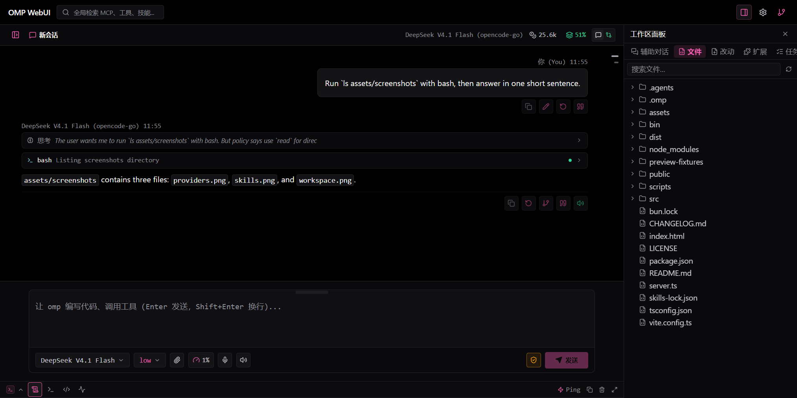
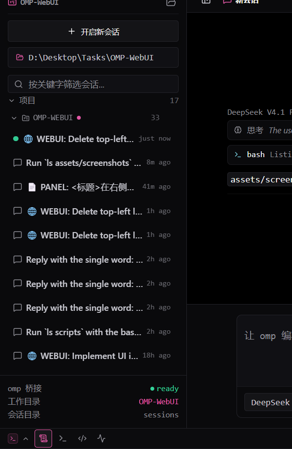
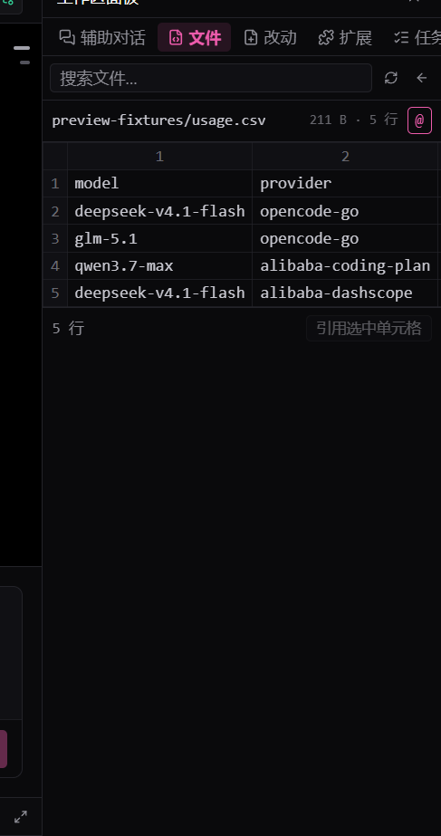
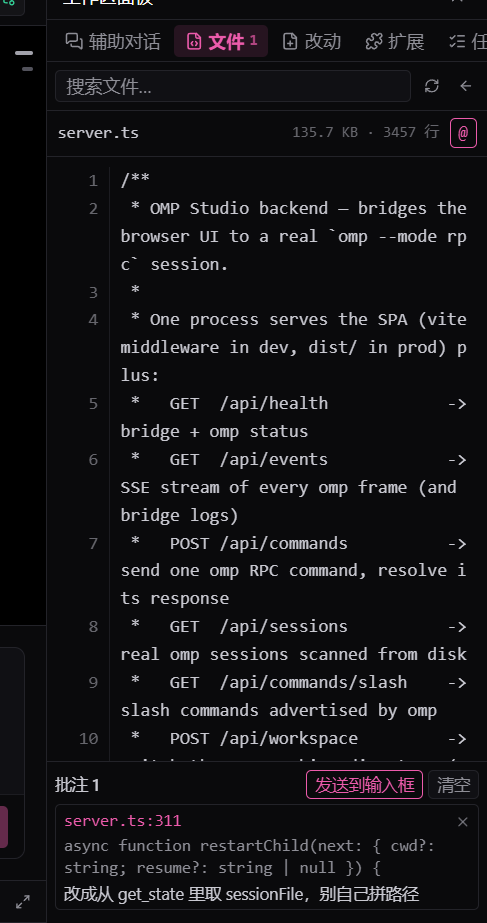
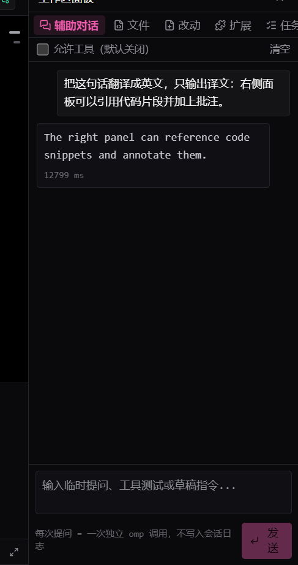
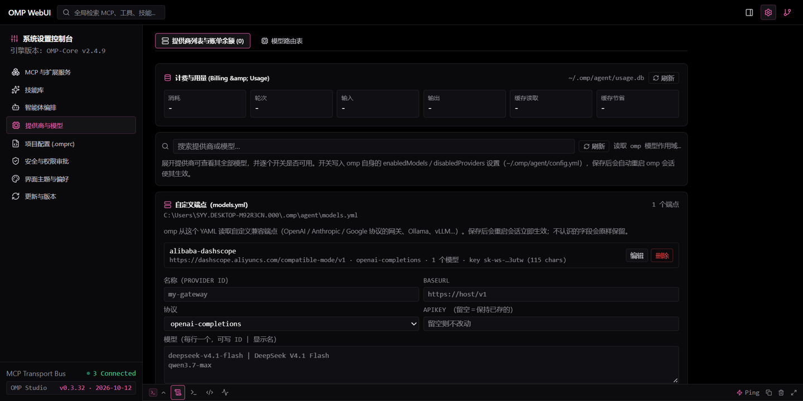
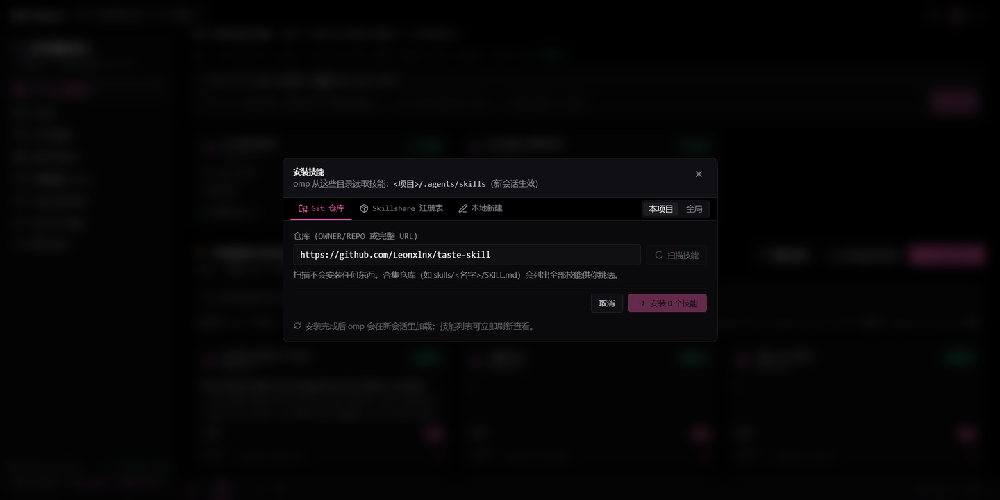

<p align="center">
  
</p>

<h1 align="center">OMP WebUI</h1>

<p align="center">
  <em>The web UI for the local <a href="https://github.com/can1357/oh-my-pi"><code>omp</code></a> coding agent.</em><br />
  <em><code>omp</code> 编码智能体的 Web 界面。</em>
</p>

<p align="center">
  <a href="https://github.com/Shang-1999/OMP-WebUI"></a>
  
  
  
  
</p>

<p align="center">
  <a href="#english">English</a> · <a href="#中文">中文</a>
</p>

<p align="center">
  
</p>

<p align="center"><sub>Chat, streaming transcript with thinking and tool blocks, composer, event console. · 对话、含思考与工具块的流式记录、输入区、事件控制台。</sub></p>

<p align="center">
  
</p>

<p align="center"><sub>Both panels in place: sessions on the left, workspace on the right. · 左右面板同时打开：左边会话，右边工作区。</sub></p>

<table align="center">
  <tr>
    <td align="center" width="33%">
      
      <br /><sub>Sessions by project folder, collapsible and removable from the list.<br />按项目文件夹分组的会话，可折叠、可从列表移除。</sub>
    </td>
    <td align="center" width="33%">
      
      <br /><sub>CSV, TSV and workbooks open as real tables.<br />CSV / TSV / 表格文件按表格打开。</sub>
    </td>
    <td align="center" width="33%">
      
      <br /><sub>Quote a passage, note it, send the tray to the composer.<br />引用一段、写批注、把托盘发进输入框。</sub>
    </td>
  </tr>
  <tr>
    <td align="center" width="33%">
      
      <br /><sub>Side chat: standalone omp runs, tools opt-in.<br />辅助对话：独立调用，工具可选。</sub>
    </td>
    <td align="center" width="33%">
      
      <br /><sub>Quota windows, per-model tests, custom endpoints.<br />额度窗口、逐模型测试、自定义端点。</sub>
    </td>
    <td align="center" width="33%">
      
      <br /><sub>Scan a skill repository, pick, install.<br />扫描技能仓库、勾选、安装。</sub>
    </td>
  </tr>
</table>

---

## English

### What it is

OMP WebUI (package name `omp-studio`) is a single-process web app that drives the **locally installed `omp`** binary over its RPC interface. Nothing about the agent is reimplemented: the chat is a real `omp --mode rpc-ui` process, the session list is read from `~/.omp/agent/sessions`, the metrics come from the session log and `usage.db`, and every action (skills, extensions, models, git, workspace switching) goes through omp's own CLI or settings files.

It exists because the terminal is great for the agent and awkward for everything around it: reading a long diff, skimming a transcript, toggling a skill, checking quota, or comparing two sessions.

### Features

| Area | What you get |
| --- | --- |
| **Chat** | Streaming text, thinking blocks, tool calls and results, abort, steer/queue mid-turn, per-model thinking level, slash commands with categorised completion (`/skill`, `/todo`, `/compact`, `/context`), edit a past prompt to branch and re-run it (like the terminal) |
| **Sessions** | Real list grouped by project folder (collapsible, removable from the sidebar), open, delete, archive, restore, fork, full-history and content search, resume on start |
| **Metrics** | Session tokens, cost and prompt-cache hit rate summed from omp's own session log (every call, not just the trimmed transcript), plus live tokens/second while a turn streams |
| **Providers** | Real quota windows (`5h` / weekly / monthly / `30d`) from `omp usage --json`, plan type, reset credits, billing from `usage.db`, per-model enable/disable through omp's `enabledModels`, add a model by id, test a model with one real request, refresh a provider catalog |
| **Custom endpoints** | A panel that edits `~/.omp/agent/models.yml`: any gateway speaking a supported API becomes a provider here (Ollama, vLLM, LM Studio, a proxy). Unmanaged fields survive edits, saving restarts the session |
| **Skills** | Scan a git repository with the Agent Skills CLI, pick from what it ships, install into the project or user scope, install from the Skillshare registry through `omp skill install`, author a `SKILL.md`, enable/disable globally or per project, uninstall |
| **Extensions** | Installed omp plugins with their real state, global and per-project switches, plugin install from npm or git |
| **Git** | Branches, checkout, commits, recent log, uncommitted files with status chips and inline patches. A workspace that is not a repository says so instead of failing |
| **Files** | Workspace tree; previews for text (encoding detection: UTF-8, UTF-16, GBK), Markdown, images, PDF, CSV/TSV tables, `.xlsx`/`.xls`/`.xlsb`/`.ods` workbooks, `.docx`/`.odt` documents, `.pptx` slides and `.ipynb` notebooks; an honest notice for binary and legacy Office files; diffs panel for the working tree |
| **Review notes** | Quote a highlight (`@file:12-18`), a paragraph, a slide or a notebook cell, or circle a region on an image — write what should change, collect notes across files, send them as one prompt |
| **Console** | Event stream with real bridge round-trip ping, plus MCP, bash, PowerShell and debugger tabs |
| **Settings** | Theme palettes including omp's own midnight palette, accent, density, fonts, UI language (zh/en), omp version check and update, approval mode, security overview, MCP servers, project config |

### Quote and annotate in the preview

The right panel is not a read-only viewer: highlight text in the source view (or click a line, a paragraph, a notebook cell or a slide) and a small box opens with the anchored reference (`file:lines`) and the quoted text. Write what should change and either ask straight away or drop it in the notes tray; `发送到输入框` turns the whole tray into one prompt with every `@file:lines` reference and its quote. On an image, drag a rectangle: the exact pixels are cropped into `.omp-studio/annotations/` and referenced as a real `@path`, so the agent opens the region you drew on rather than guessing from coordinates.

<p align="center">
  
</p>

### Quickstart

```bash
git clone https://github.com/Shang-1999/OMP-WebUI.git
cd OMP-WebUI
bun install          # or: npm install
bun run dev          # http://localhost:3000
```

`bun run dev` starts one process that serves the SPA (Vite middleware) **and** the bridge API, and spawns `omp` in the current directory. Production: `bun run build && bun run start`.

Install it as a global command (the repository is a package, `bin/omp-studio.mjs` is the entry point):

```bash
npm i -g .           # provides `omp-studio`; `prepare` builds dist/ for you
omp-studio           # serves dist/ and runs omp in the directory you launched from
```

Requirements: `omp` on `PATH` (or `OMP_BIN`), Node.js 22+ or Bun.

### Environment

| Variable | Default | Purpose |
| --- | --- | --- |
| `PORT` / `HOST` | `3000` / `0.0.0.0` | HTTP listener |
| `OMP_BIN` | `omp` | Agent executable |
| `OMP_CWD` | process cwd | Working directory for the omp session |
| `OMP_RESUME` | - | Session `.jsonl` to resume on startup |
| `OMP_ARGS` | - | Extra argv passed to `omp` |
| `OMP_SESSION_ROOT` | `~/.omp/agent/sessions` | Where sessions are listed from |
| `OMP_ARCHIVE_ROOT` | `<session root>/../archive/sessions` | Where archived sessions live |
| `OMP_AGENT_DIR` | `~/.omp/agent` | omp's agent directory (`config.yml`, `models.yml`, `usage.db`) |
| `OMP_SKILLS_DIR` | `~/.agents/skills` | User skill directory |

### How it works

```
browser ──HTTP/SSE──> server.ts (Express) ──stdin/stdout JSON──> omp --mode rpc-ui
   │                        │
   └── SPA (Vite/dist)      └── reads omp's files: sessions, config.yml, models.yml,
                                auth store, usage.db, models.db
```

* One Express process hosts both the SPA and ~54 JSON endpoints; the dev server mounts Vite as middleware, production serves `dist/`.
* `/api/events` streams omp's frames (SSE) and the bridge's own log lines to the UI. Every frame carries the `sessionKey` of the conversation it belongs to.
* The bridge keeps **one `omp --mode rpc-ui` child per open conversation**, forwards commands, and adds the flags omp needs for the project scope (`--skills=`, `--no-extensions`). Opening another conversation attaches to (or starts) its own child, so a turn that is running keeps running; the pool is bounded at four children, oldest idle first.
* A settings change restarts every open child with its **same session file** (`--resume`), so toggling a skill never loses a conversation.
* Panels read omp's files directly: `usage.db` for billing, `models.db` for catalogs, the session `.jsonl` for metrics, and `git` for the repository surfaces.

### Development

```bash
bun run lint         # tsc --noEmit
bun run test:e2e     # 26 bridge checks against a running dev server
bun run build        # production SPA into dist/
```

### License

Apache-2.0, see [LICENSE](LICENSE). Built on top of omp and Pi; see credits at the end.

---

## 中文

### 这是什么

OMP WebUI（包名 `omp-studio`）是一个单进程 Web 应用，通过 RPC 驱动**本机安装的 `omp`**。智能体本身没有任何重写：聊天是一个真实的 `omp --mode rpc-ui` 进程，会话列表来自 `~/.omp/agent/sessions`，指标来自会话日志与 `usage.db`，所有操作（技能、扩展、模型、git、切换工作目录）都走 omp 自己的 CLI 或设置文件。

做它的原因很实际：终端跑智能体很好用，但读长 diff、翻长记录、开关一个技能、看额度、对比两个会话都很别扭。

### 功能

| 模块 | 内容 |
| --- | --- |
| **对话** | 流式正文、思考块、工具调用与结果、中断、回合中 steer/queue、按模型切换思考强度、斜杠命令与分类补全（`/skill`、`/todo`、`/compact`、`/context`）、**编辑历史提问并从该轮分叉重跑**（同 omp 终端） |
| **会话** | 按项目文件夹分组的真实列表（可折叠、可从侧栏移除）、打开、删除、归档、恢复、fork、全历史与内容搜索、启动时续接 |
| **指标** | 本会话 token、成本、提示词缓存命中率，直接汇总 omp 会话日志的每一次调用（不是被裁剪的 transcript），生成中还有实时 tokens/秒 |
| **提供商** | 来自 `omp usage --json` 的真实额度窗口（5 小时 / 每周 / 每月 / 30 天）、计划类型、重置额度、`usage.db` 计费、按模型启停（写 omp 的 `enabledModels`）、按 id 添加模型、**发一次真实请求测试模型**、刷新提供商目录 |
| **自定义端点** | 直接编辑 `~/.omp/agent/models.yml`：任何支持已实现协议的网关（Ollama、vLLM、LM Studio、代理）都能在这里变成提供商。不认识的字段会原样保留，保存后重启会话生效 |
| **技能** | 用 Agent Skills CLI 扫描 Git 仓库并挑选安装（项目级 / 全局）、通过 `omp skill install` 装 Skillshare 注册表、本地新建 `SKILL.md`、全局或按项目启停、卸载 |
| **扩展** | 已装 omp 插件的真实状态、全局与本项目开关、从 npm 或 git 安装插件 |
| **Git** | 分支、切换、提交、近期日志、未提交文件（状态标签 + 行内补丁）；工作目录不是仓库时如实说明而不是报错 |
| **文件** | 工作区文件树、带编码探测的文本预览（UTF-8 / UTF-16 / GBK）、二进制文件给出明确提示、工作区改动 diff 面板 |
| **控制台** | 事件流（真实桥接往返 Ping）、MCP / bash / PowerShell / 调试器页签 |
| **设置** | 主题色板（含 omp.sh 午夜黑）、强调色、排版密度、字体、界面语言（中/英）、omp 版本检查与更新、审批模式、安全总览、MCP 服务、项目配置 |

### 在预览里引用与批注

右侧面板不是只读预览：在源码里选中一段（或点行号、段落、notebook 单元格、幻灯片）会弹出小浮层，带上锚定引用（`文件:行号`）和选中的原文。写下要改什么，可以直接提问，也可以放进批注托盘；托盘里的「发送到输入框」会把所有批注拼成一条提示，每条都带 `@文件:行号` 与引文。图片上直接拖出一个矩形，那块像素会被真的裁到 `.omp-studio/annotations/` 并以 `@path` 引用 —— 智能体打开的是你圈的那块图，不是靠坐标猜。

### 快速开始

```bash
git clone https://github.com/Shang-1999/OMP-WebUI.git
cd OMP-WebUI
bun install          # 或 npm install
bun run dev          # http://localhost:3000
```

`bun run dev` 单进程同时提供 SPA（Vite middleware）与桥接 API，并在当前目录拉起 `omp`。生产模式：`bun run build && bun run start`。

也可以装成全局命令（仓库本身是个包，入口是 `bin/omp-studio.mjs`）：

```bash
npm i -g .           # 提供 omp-studio 命令；prepare 会自动构建 dist/
omp-studio           # 服务 dist/，omp 使用你启动命令时所在的目录
```

前提：`omp` 在 `PATH` 上（或设 `OMP_BIN`），Node.js 22+ 或 Bun。

### 环境变量

| 变量 | 默认值 | 用途 |
| --- | --- | --- |
| `PORT` / `HOST` | `3000` / `0.0.0.0` | HTTP 监听 |
| `OMP_BIN` | `omp` | 智能体可执行文件 |
| `OMP_CWD` | 进程工作目录 | omp 会话的工作目录 |
| `OMP_RESUME` | - | 启动时续接的会话 `.jsonl` |
| `OMP_ARGS` | - | 追加给 `omp` 的参数 |
| `OMP_SESSION_ROOT` | `~/.omp/agent/sessions` | 会话列表来源 |
| `OMP_ARCHIVE_ROOT` | `<会话根>/../archive/sessions` | 归档会话位置 |
| `OMP_AGENT_DIR` | `~/.omp/agent` | omp 的 agent 目录（`config.yml`、`models.yml`、`usage.db`） |
| `OMP_SKILLS_DIR` | `~/.agents/skills` | 用户技能目录 |

### 工作原理

```
浏览器 ──HTTP/SSE──> server.ts (Express) ──stdin/stdout JSON──> omp --mode rpc-ui
   │                      │
   └── SPA（Vite/dist）    └── 读取 omp 的文件：会话、config.yml、models.yml、
                              凭据库、usage.db、models.db
```

* 一个 Express 进程同时托管 SPA 与约 54 个 JSON 接口；开发时用 Vite middleware，生产直接服务 `dist/`。
* `/api/events` 用 SSE 把 omp 的帧和桥接自己的日志推给前端。
* 桥接启动 `omp --mode rpc-ui`，转发命令，并补上项目作用域需要的参数（`--skills=`、`--no-extensions`）。
* 设置变化会重启子进程并**续接同一个会话文件**（`--resume`），所以切换技能不会丢对话。
* 各面板直接读 omp 的文件：计费读 `usage.db`，模型目录读 `models.db`，指标读会话 `.jsonl`，仓库相关调 `git`。

### 开发

```bash
bun run lint         # tsc --noEmit
bun run test:e2e     # 针对运行中的开发服务做 18 项桥接检查
bun run build        # 生产构建到 dist/
```

### 许可

Apache-2.0，见 [LICENSE](LICENSE)。基于 omp 与 Pi 构建，见下方致谢。

---

## Credits

* [**omp**](https://github.com/can1357/oh-my-pi) by Stencil Labs, and [**Pi**](https://github.com/earendil-works/pi), the harness this workspace drives.
* [**pi-web**](https://github.com/agegr/pi-web), whose palette and token system the design tokens were ported from.
* [**Taste Skill**](https://github.com/Leonxlnx/taste-skill), used as a development skill for the UI passes.
